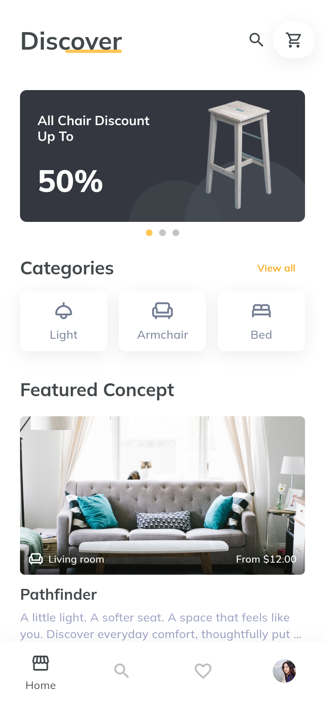
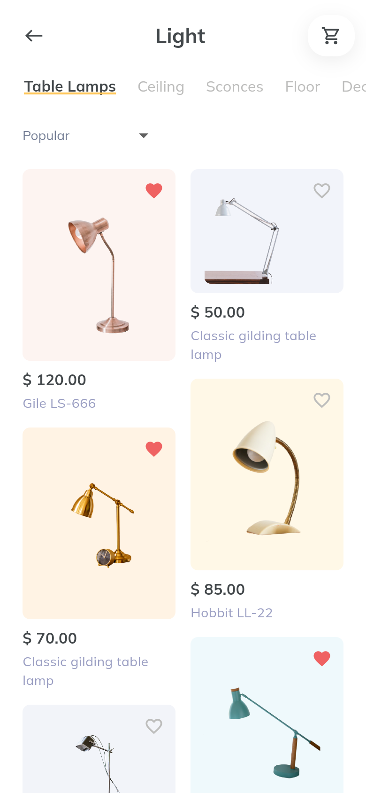
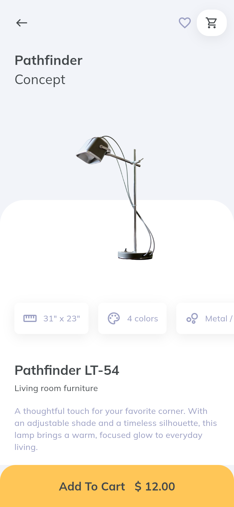
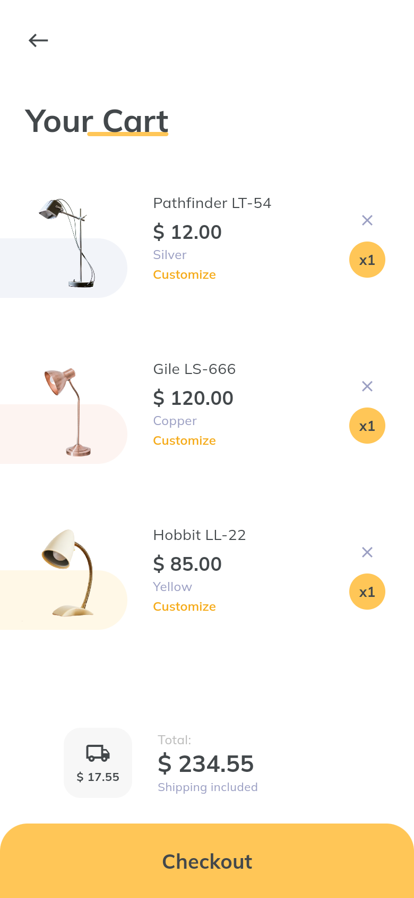
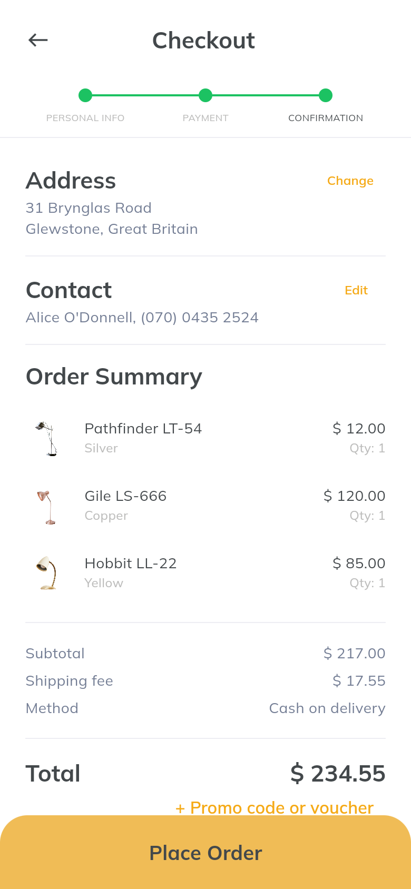
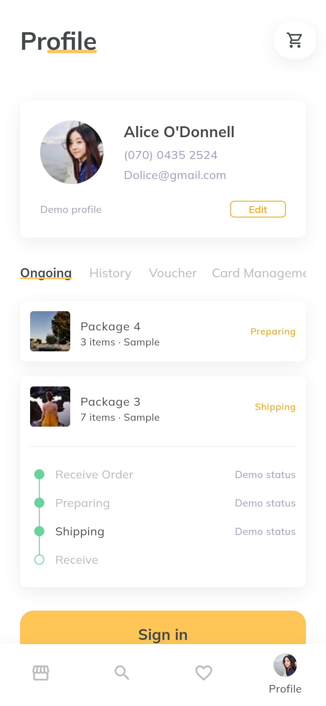

# Furnite Furniture

根据 Pixso 中的 Furnite 家具商城 UI 开发的 Flutter App。保留暖黄色、白色留白、Muli 字体、商品瀑布流和实景家居图片，支持从浏览、收藏、加购到结算和查看订单的完整本地演示。

## 主要界面

以下图片来自实际运行的 Flutter Web App，使用 Chrome、390 × 844 逻辑像素、2 倍像素密度采集。

| 发现首页 | 商品列表 | 商品详情 |
| --- | --- | --- |
|  |  |  |

| 购物车 | 结算确认 | 个人中心 |
| --- | --- | --- |
|  |  |  |

全部 **38 张**页面和操作状态截图见 [界面截图目录](docs/SCREENSHOTS.md)。项目分层、文件职责、路由、数据流与设计对应关系见 [项目架构说明](docs/PROJECT.md)。

## 已实现

- 发现首页、促销轮播、分类入口、灯具分类、双列商品列表和价格排序。
- 商品详情、颜色与数量选择、推荐商品、家居方案、设计特点弹层、可缩放相册。
- 商品与方案收藏、关键词搜索、无结果状态。
- 购物车加购、同规格合并、数量和颜色修改、删除确认及空购物车。
- 地址信息 → 付款方式 → 确认订单三步结算，支持现金和演示信用卡。
- 优惠码、金额实时计算、下单成功、订单记录和进度展示。
- 个人资料和地址编辑、优惠券、银行卡末四位管理。
- 登录、注册、找回密码的表单与交互演示。
- 收藏、购物车、个人资料、订单、卡片末四位和演示登录状态本地持久化。

## 运行

已验证环境：Flutter **3.41.6**、Dart **3.11.4**。

```bash
flutter pub get
flutter run -d chrome
```

也可以在已配置的原生环境运行：

```bash
flutter run -d macos
flutter devices
flutter run -d <设备ID>
```

直接预览 Web 构建：

```bash
flutter build web --no-web-resources-cdn
python3 -m http.server 8080 --bind 127.0.0.1 --directory build/web
```

然后打开 [本地预览](http://127.0.0.1:8080)。例如 `/#/products`、`/#/product/pathfinder` 可直接进入对应页面。

## 演示流程

1. 首页 → 分类 → Light → Table Lamps → 选择商品。
2. 选择颜色和数量，加入购物车；可在购物车再次修改规格。
3. Checkout → 确认地址 → 选择 Cash 或演示信用卡 → 确认订单。
4. 使用 `FURNITE10` 获得商品金额 10% 的演示优惠。
5. 下单后购物车清空，订单出现在 Profile → Ongoing，刷新后仍保留。

信用卡测试数据：`4242 4242 4242 4242`、`12/30`、`123`。登录接受任意格式正确的邮箱和至少 6 位密码；找回密码演示验证码是 `246810`。

这是可运行的 UI 与本地业务原型：没有连接账号、支付、物流或商品服务，不产生真实扣款和配送。密码、完整卡号和 CVV 不保存。除灯具中的桌灯外，其余分类目前提供明确的待上架状态。细节见架构文档中的范围说明。

## 验证与截图

```bash
flutter analyze
flutter test
flutter build web --no-web-resources-cdn
flutter build macos
flutter build apk --debug
```

8 项自动化测试覆盖购物车与优惠计算、持久化、非法缓存恢复、表单校验、页面路由、完整下单流程，以及 320 / 520 宽度和 1.3 倍系统字体。浏览器截图脚本另外验证实际页面交互与刷新后的数据。

交付检查：静态分析无问题、8 项测试全部通过，Web / macOS / Android debug 构建成功。

本机构建产物：

- [Android 调试 APK](build/app/outputs/flutter-apk/app-debug.apk)
- macOS：`build/macos/Build/Products/Release/furnite.app`
- Web：`build/web/`

本机模拟器镜像不可用，未进行 iOS / Android 模拟器运行测试；截图来自实际浏览器渲染。

重新截图时，先启动上面的 Web 静态服务，再运行：

```bash
cd tools
npm install
npm run capture
```

截图工具需要已安装的 Google Chrome。它使用独立浏览器上下文，不读取日常浏览器数据。详细采集结果保存在 `docs/screenshots/verification.json`。

## 代码组织

```text
lib/
├── main.dart                 # 启动、恢复本地状态
├── app.dart                  # 主题、路由、宽屏居中布局
├── core/                     # 设计样式、表单校验
├── data/                     # 商品、方案、分类模型和演示数据
├── state/                    # 购物状态、金额计算、本地持久化
├── widgets/                  # 页面框架、卡片、表单、颜色和数量控件
└── screens/                  # 发现、商品、购物车、结算、账户页面
```

运行时仅使用 Flutter SDK 和 `shared_preferences`。已合并重复界面状态与公共控件，未引入导出器生成的绝对定位辅助代码、额外路由库或状态管理依赖。
