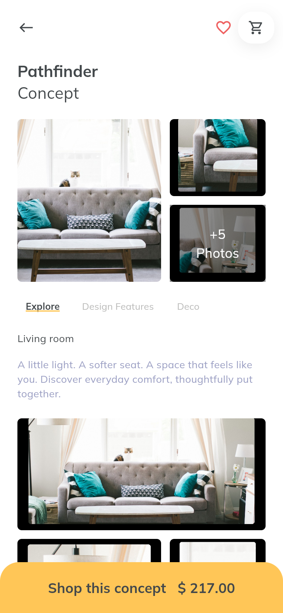
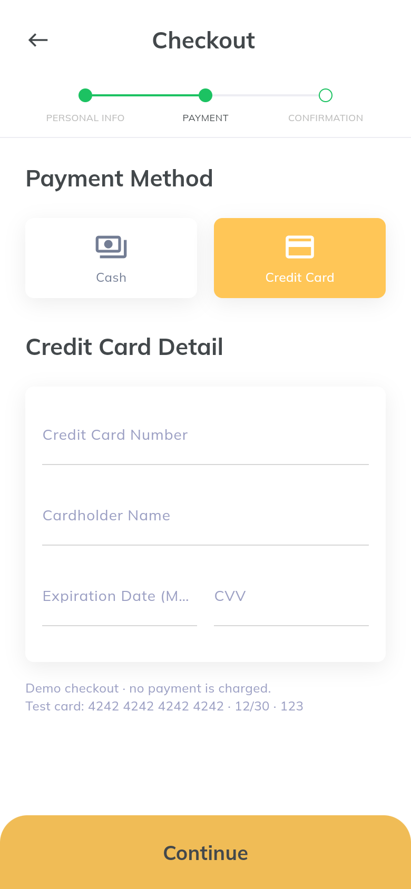

# Furnite Flutter 项目与架构说明

## 1. 项目目标和设计来源

将 Pixso 文件中 Design 页的 Furnite 家具商城设计实现为可运行的 Flutter App，并提供独立页面截图与可复现的验证方式。

读取了首页、分类、商品浏览、商品详情、购物车、结算、个人中心、登录等主要画板，也检查了搜索、收藏、家居方案、支付表单、资料编辑及恢复密码相关画板。设计中的多张画板表达的是同一界面的输入、弹层、选中或完成状态，在实现中通过状态切换表达。

关键设计节点：

| Pixso 节点 | 设计画板 | 实现 |
| --- | --- | --- |
| `0:3` | Home | Discover 首页 |
| `0:3834` | Categories | 全部分类 |
| `0:36` | Light Categories | 灯具分类 |
| `0:137` | Product Browser | 商品列表、排序 |
| `0:308` | Item Detail | 商品详情、选色、数量 |
| `0:375` | Concept View | 方案详情、设计特点和配套商品 |
| `0:851` / `0:852` | Search / Saved | 搜索与收藏 |
| `0:402` | Cart | 购物车、编辑和删除 |
| `0:482` / `0:589` / `0:678` | Checkout | 信息、付款、确认三步 |
| `0:1048` | Profile | 个人中心、订单进度 |
| `0:1726` / `0:1693` | Profile Edit / Card | 资料编辑、银行卡管理 |
| `0:2` / `0:1052` / `0:3359` | Sign in / Sign up / Recovery | 账户交互演示 |

图片来自该设计文件的商品图、场景图及头像；宣传横幅和分类图片从对应节点导出。字体使用 Muli 的后续名称 Mulish，以 `Muli` 家族名在应用中注册；许可位于 `assets/fonts/OFL.txt`。无需运行时网络图片或字体请求。

## 2. 技术方案

| 项目 | 选择 |
| --- | --- |
| UI | Flutter / Material 3，自定义样式对齐 Pixso |
| 工具链 | Flutter 3.41.6 / Dart 3.11.4 |
| 状态管理 | `ChangeNotifier` + `InheritedNotifier` |
| 页面导航 | Flutter `Navigator` + 命名路由 |
| 持久化 | `shared_preferences`，版本化 JSON |
| 图片与字体 | 本地 assets |
| 业务验证 | `flutter_test` |
| 实际界面截图 | Playwright + Chrome，Flutter Web CanvasKit |
| 平台工程 | Android / iOS / macOS / Web |

宽屏时内容区最大宽度 520，保持移动端阅读比例；页面列表可滚动，系统安全区由 `SafeArea` 处理。数量、颜色选择和结算数据来自同一个状态对象。

## 3. 完整目录结构

```text
FurniteFurniture/
├── README.md                         # 总览、主要界面、快速启动
├── pubspec.yaml                      # Flutter 依赖、图片和字体注册
├── pubspec.lock                      # 锁定依赖
├── analysis_options.yaml             # Flutter lint 配置
├── lib/
│   ├── main.dart                     # 读取持久化状态后启动
│   ├── app.dart                      # 应用配置与路由工厂
│   ├── core/
│   │   ├── theme.dart                # 色板、字号、阴影、输入样式
│   │   └── validation.dart           # 邮箱、电话、密码、卡号、有效期校验
│   ├── data/
│   │   └── catalog.dart              # Product / RoomConcept / ShopCategory
│   ├── state/
│   │   └── shop_state.dart           # CartLine / ShopOrder / ShopState / ShopScope
│   ├── widgets/
│   │   ├── shop_widgets.dart         # 页面、导航、卡片、按钮、空状态
│   │   └── form_fields.dart          # 输入项与复用信用卡表单
│   └── screens/
│       ├── discover.dart             # 首页、分类、商品列表、搜索、收藏
│       ├── product.dart              # 商品、方案、相册、选色控件
│       ├── cart.dart                 # 购物车、规格编辑、删除确认
│       ├── checkout.dart             # 三步结算、优惠码、下单成功
│       ├── profile.dart              # 订单、优惠券、资料与卡片
│       └── auth.dart                 # 登录、注册、找回密码
├── assets/
│   ├── fonts/                        # Mulish 可变字体和 OFL 许可
│   └── images/                       # 商品、场景、分类、横幅和头像
├── test/
│   ├── shop_state_test.dart          # 金额、规格、缓存、表单单元测试
│   └── app_test.dart                 # 路由与页面交互测试
├── tools/
│   ├── package.json                  # 独立截图开发工具依赖
│   └── capture_screenshots.cjs       # 实际浏览器流程与 PNG 截图
├── docs/
│   ├── PROJECT.md                    # 本文档
│   ├── SCREENSHOTS.md                # 所有截图索引和缩略图
│   └── screenshots/                  # 实际 App PNG 与验证记录
├── android/                          # Android 原生工程
├── ios/                              # iOS 原生工程
├── macos/                            # macOS 原生工程
└── web/                              # Web 入口及应用清单
```

## 4. 分层与数据流

```text
用户操作
  ↓
Screen / 公共 Widget
  ↓  ShopScope.of(context)
ShopState（状态变更、校验后的业务操作、金额计算）
  ├── notifyListeners → 依赖状态的界面更新
  └── 串行写入队列 → SharedPreferences JSON

启动 → ShopState.load → 恢复 JSON → FurniteApp → 初始路由
```

界面不直接读写 `SharedPreferences`，收藏、订单和金额计算集中在 `ShopState`。`catalog.dart` 保存静态商品数据；购物车只引用商品 ID、颜色和数量。

该规模采用直接分层，避免为本地数据引入空的 Repository、网络层、依赖注入框架或多套状态。后续接入后端时，可将商品目录、账号和订单读写分别替换为服务接口，保留现有界面与模型。

### 购物车和金额

- 同商品 ID + 同颜色合并；不同颜色保留为不同购物行。
- 数量限制为 1–99。删除需要确认，最后一件删除后运费为 0。
- 金额统一使用整数美分，最后显示时才除以 100。
- 运费为演示固定值 $17.55；`FURNITE10` 折扣仅作用于商品小计。
- 下单复制购物行，生成本地订单，再清空购物车；后续购物不会修改旧订单。
- 空购物车不能创建订单，连续提交不会产生第二笔空订单。

原设计中购物车和确认页的合计与商品单价存在不一致，实现使用统一公式。例如三件商品 $12 + $120 + $85 = $217；含运费 $234.55；商品 10% 优惠后为 **$212.85**。

### 持久化

存储键为 `furnite.state.v1`，包括购物车、收藏商品、收藏方案、订单、用户资料、地址、演示登录状态、优惠码及卡片末四位。写入采用串行队列，避免快速操作时较早的快照覆盖较新的状态。不能解码的缓存不会阻止启动。

密码、完整卡号和 CVV 只用于当前表单校验，不保存到本地。卡号校验包含 Luhn 校验，有效期校验包含月份与过期检查。

## 5. 路由和界面

| 路由 | 页面或状态 |
| --- | --- |
| `/` | 首页、轮播、精选及趋势方案 |
| `/categories` | 全部分类 |
| `/category/Light` | 灯具分类 |
| `/category/Armchair` 等 | 其他分类的待上架状态 |
| `/products` | 桌灯商品瀑布流、排序 |
| `/products?type=Floor%20Lamps` | 其他灯具类型的待上架状态 |
| `/product/pathfinder` 等 | 商品详情、颜色、数量和推荐 |
| `/concept/pathfinder` 等 | 方案详情、特点、搭配商品 |
| `/gallery` | 相册；支持左右翻页和缩放 |
| `/search` | 搜索建议、即时结果和无结果状态 |
| `/saved` | 全部 / 方案 / 商品收藏筛选 |
| `/cart` | 购物车、空状态、规格和删除弹层 |
| `/checkout` | 信息 / 付款 / 确认，含优惠码弹层 |
| `/success` | 最近一笔本地订单的成功页面 |
| `/profile` | 订单、示例包裹、资料卡片 |
| `/profile?tab=1` | 历史订单空状态 |
| `/profile?tab=2` | 优惠券 |
| `/profile?tab=3` | 银行卡管理 |
| `/profile/edit` | 资料与地址编辑 |
| `/card/add` | 演示银行卡表单 |
| `/signin` / `/signup` | 登录 / 注册演示 |
| `/recovery` | 邮箱 → 验证码 → 新密码 |

Web URL 使用 `/#/路由`。未知路由显示可返回首页的提示。首页、搜索、收藏和个人中心共用底部导航；深层页面共用返回和购物车入口。

## 6. 主要界面图片

| 发现 | 商品选择 | 家居方案 |
| --- | --- | --- |
|  |  |  |

| 购物车 | 付款方式 | 订单确认 |
| --- | --- | --- |
|  |  |  |

完整页面及弹层图片见 [SCREENSHOTS.md](SCREENSHOTS.md)。

## 7. 设计还原和代码精简

主色 `#FFC657`，强调色 `#F5AA17`，正文 `#43484B`，辅助文字 `#9B9FC3`；主题集中在 `theme.dart`，字号、阴影、输入框和按钮统一维护。

图片做了去重与适度压缩，使用清晰的本地文件名。公共页面、导航、按钮、商品卡片、方案卡片、空状态、数量控件和表单集中复用。登录 / 注册、结算三步和个人中心各状态共用页面逻辑，避免按画板数量生成重复页面。

运行时没有采用导出器的大量绝对定位包装层、屏幕比例辅助文件、重复矢量图片与无用变量管理器。页面用 Flutter 原生布局与滚动容器实现，并保留主要间距、原图、字形和层级。图标使用语义相同的 Flutter 内置图标；底部导航增加独立搜索入口，部分控件与原稿会有细节差异。

## 8. 验证与环境说明

执行 `flutter analyze`、`flutter test`，并构建 Web、macOS。8 项测试包含：

1. 购物车同规格合并、不同颜色拆行、数量上限与整数金额。
2. 无效优惠码拒绝、10% 优惠和下单清空、重复空提交防护。
3. 资料、购物车、收藏、订单与卡片末四位的持久化恢复。
4. 非法缓存恢复与邮箱、信用卡、有效期校验。
5. 所有主要路由加载、搜索无结果、完整结算与恢复密码流程。
6. 收藏、加购、进入购物车和删除确认交互。
7. 320 / 520 逻辑像素宽度及 1.3 倍系统字体下的布局。

浏览器脚本从新上下文开始，通过实际按钮和表单完成加购、规格编辑、现金结算、优惠码、下单、刷新、银行卡和恢复密码。截图采集记录与浏览器版本见 `screenshots/verification.json`。

本机 iOS 模拟器运行时不可用；已有 Android AVD 缺少启动所需的 system image，不能启动。因此截图来自真实 Flutter Web 渲染，不标为 iOS 或 Android 模拟器截图。Android 与 iOS 工程均已准备，可在配置完整的设备环境继续运行。构建结果与产物位置见项目根目录的运行说明。

## 9. 当前范围

这是以 Pixso 参考为基础的离线 UI / 业务演示，未接真实服务：

- 目录包含 6 件桌灯和 6 套家居方案；分类中的商品数量是设计文案，其他分类显示待上架。
- 登录 / 注册只进行本地校验并进入演示账号，不注册真实账户；恢复密码不发邮件、不改变真实密码。
- 下单是本地记录；现金与信用卡均不发起交易和配送。
- 订单页包含明确标记的 Sample 包裹，用于展示原稿中的折叠和物流时间线；新订单保存为 Preparing。
- 资料页支持一组收货信息；不连接地址簿或多地址服务。
- 颜色选择记录为购物规格；原稿商品图保持原有颜色，不生成重新着色的商品图。
- 数据存储在当前设备；卸载应用或清除浏览器站点数据会移除演示记录。

交付时保留可运行源代码、测试、截图工具、所有截图、字体许可和本说明，便于继续接入正式服务。
