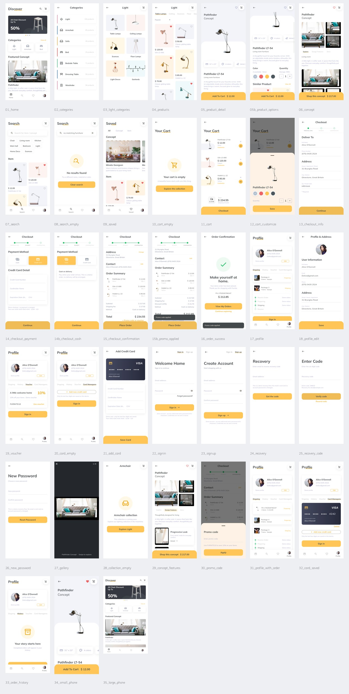

# 界面截图目录

共 38 张实际 Flutter App 截图，包含页面、弹层、空状态和关键操作结果。采集环境为 Chrome / Flutter Web CanvasKit；常规截图 390 × 844 逻辑像素，2 倍像素密度。小屏和大屏适配截图分别为 320 × 700、520 × 900。

[返回项目说明](../README.md) · [项目结构与架构](PROJECT.md) · [浏览器验证记录](screenshots/verification.json)

## 全部界面概览

## 原始 PNG

点击文件名可查看原始图片。截图保存的是实际页面首屏；可滚动的详情另附规格区域截图。

| 图片 | 界面 / 状态 | 像素尺寸 |
| --- | --- | --- |
| [01_home.png](screenshots/01_home.png) | 发现首页 | 780 × 1688 |
| [02_categories.png](screenshots/02_categories.png) | 全部分类 | 780 × 1688 |
| [03_light_categories.png](screenshots/03_light_categories.png) | 灯具分类 | 780 × 1688 |
| [04_products.png](screenshots/04_products.png) | 商品列表 | 780 × 1688 |
| [05_product_detail.png](screenshots/05_product_detail.png) | 商品详情 | 780 × 1688 |
| [05b_product_options.png](screenshots/05b_product_options.png) | 商品规格和推荐 | 780 × 1688 |
| [06_concept.png](screenshots/06_concept.png) | 家居方案 | 780 × 1688 |
| [07_search.png](screenshots/07_search.png) | 搜索 | 780 × 1688 |
| [08_search_empty.png](screenshots/08_search_empty.png) | 搜索无结果 | 780 × 1688 |
| [09_saved.png](screenshots/09_saved.png) | 收藏 | 780 × 1688 |
| [10_cart_empty.png](screenshots/10_cart_empty.png) | 空购物车 | 780 × 1688 |
| [11_cart.png](screenshots/11_cart.png) | 购物车 | 780 × 1688 |
| [12_cart_customize.png](screenshots/12_cart_customize.png) | 购物车规格编辑 | 780 × 1688 |
| [13_checkout_info.png](screenshots/13_checkout_info.png) | 结算收货信息 | 780 × 1688 |
| [14_checkout_payment.png](screenshots/14_checkout_payment.png) | 信用卡付款 | 780 × 1688 |
| [14b_checkout_cash.png](screenshots/14b_checkout_cash.png) | 现金付款 | 780 × 1688 |
| [15_checkout_confirmation.png](screenshots/15_checkout_confirmation.png) | 订单确认 | 780 × 1688 |
| [15b_promo_applied.png](screenshots/15b_promo_applied.png) | 优惠码已应用 | 780 × 1688 |
| [16_order_success.png](screenshots/16_order_success.png) | 下单成功 | 780 × 1688 |
| [17_profile.png](screenshots/17_profile.png) | 个人中心 | 780 × 1688 |
| [18_profile_edit.png](screenshots/18_profile_edit.png) | 资料与地址编辑 | 780 × 1688 |
| [19_voucher.png](screenshots/19_voucher.png) | 优惠券 | 780 × 1688 |
| [20_card_empty.png](screenshots/20_card_empty.png) | 银行卡空状态 | 780 × 1688 |
| [21_add_card.png](screenshots/21_add_card.png) | 添加银行卡 | 780 × 1688 |
| [22_signin.png](screenshots/22_signin.png) | 登录 | 780 × 1688 |
| [23_signup.png](screenshots/23_signup.png) | 注册 | 780 × 1688 |
| [24_recovery.png](screenshots/24_recovery.png) | 找回密码 | 780 × 1688 |
| [25_recovery_code.png](screenshots/25_recovery_code.png) | 恢复验证码 | 780 × 1688 |
| [26_new_password.png](screenshots/26_new_password.png) | 设置新密码 | 780 × 1688 |
| [27_gallery.png](screenshots/27_gallery.png) | 图片相册 | 780 × 1688 |
| [28_collection_empty.png](screenshots/28_collection_empty.png) | 分类待上架 | 780 × 1688 |
| [29_concept_features.png](screenshots/29_concept_features.png) | 方案设计特点 | 780 × 1688 |
| [30_promo_code.png](screenshots/30_promo_code.png) | 优惠码输入弹层 | 780 × 1688 |
| [31_profile_with_order.png](screenshots/31_profile_with_order.png) | 已创建订单 | 780 × 1688 |
| [32_card_saved.png](screenshots/32_card_saved.png) | 银行卡已保存 | 780 × 1688 |
| [33_order_history.png](screenshots/33_order_history.png) | 订单历史空状态 | 780 × 1688 |
| [34_small_phone.png](screenshots/34_small_phone.png) | 320 宽小屏适配 | 640 × 1400 |
| [35_large_phone.png](screenshots/35_large_phone.png) | 520 宽大屏适配 | 1040 × 1800 |
